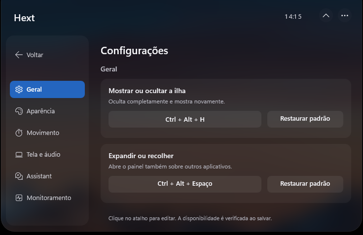

# Hext

A compact desktop island for Windows 10 and 11. Hover to expand it into a panel with an assistant, audio controls, timers, hardware readings, and file shortcuts.

Hext is written in C++17 with Win32, Direct2D, and DirectWrite. It does not require Windows activation. The interface is currently in Brazilian Portuguese; this repository's documentation is in English.



## Download and run

Download **Hext-Windows-x64.zip** from [Releases](https://github.com/starlixdev/Hext/releases), extract it into a writable folder, and run `Hext.exe`. The executable is not code-signed. Keep Windows' normal download and application checks enabled.

Hover over the compact island at the top of the desktop to expand it. Move the pointer away to collapse it. A window that leaves the island's footprint exposed does not hide it. Windows that cover that area suppress normal desktop presence.

| Shortcut | Action |
| --- | --- |
| Ctrl + Alt + H | Show or completely hide the island |
| Ctrl + Alt + Space | Expand or collapse, including above other applications |
| Esc | Close the current menu or collapse the panel |

Change both global shortcuts in **Personalizar → Geral**. Hext checks whether Windows can register a new combination before releasing the old one. Global reservations are detectable; every application's local shortcuts are not. Hext must be running for these shortcuts to work. Use the tray icon to resume desktop activation or quit.

## What is implemented

- Structured assistant actions with three global permission modes, one-use approvals, and protected Codex/Claude adapters. A compatible installed CLI and its own authentication are required; arbitrary text CLIs cannot run the protected protocol.
- Task planning across tool results, independent AI action review, on-demand configuration inside a conversation, an internal capabilities registry, and reviewed declarative skills. There is no capabilities settings catalog to manage.
- Native chat components for permission decisions, assisted setup, participation, progress and task resumption. The conversation remains visible; historical controls never restore execution authority.
- General agent tools: isolated PowerShell, public HTTPS research, authorized Windows accessibility controls, explicit package proposals, and durable task checkpoints. See [general agent boundaries](docs/agent.md).
- Encrypted saved conversations, separate bounded preference memory, and configurable response language.
- Optional Spotify PKCE connection, text search, device selection, and playback controls, subject to Spotify account and application access.
- Output and input device selection, volume, mute, stereo balance, explicit default-device switching, and Bluetooth management through Windows.
- Timers, local commands, CPU and GPU readings, RAM usage, and temporary file shortcuts.
- A reorderable sidebar, recent accent colors, a color wheel, material and scale settings, and reduced motion.

Voice recognition and notification access are not implemented. The voice animation is a labeled preview. Hardware temperatures and power depend on available sensors; missing values remain unavailable.

## Build and test

Install MinGW-w64 with `g++` and `windres`, then run in PowerShell:

```powershell
./app/build.ps1 -Preview
./scripts/test.ps1
./app/dist/Hext-preview.exe --verify-render
./app/dist/Hext-preview.exe --verify-personal
./app/dist/Hext-preview.exe --verify-permissions
```

The hidden renderer exports images and checks interaction states without recording the desktop. Build prerequisites, test boundaries, and release steps are in [Development](docs/development.md).

## Repository layout

```text
app/                 Windows application, resources, and tests
docs/                Usage, architecture, design, and development notes
scripts/             Tests and clean release packaging
.github/             CI, release workflow, and contribution templates
```

Local settings, assistant sessions, downloads, previous executables, and generated test images are excluded from version control. Release ZIPs contain a clean executable and documentation, not a developer configuration.

Choose **Sempre Perguntar**, **Aprovar por mim**, or **Permitir Sempre** in **Personalizar → Assistant → Permissões**. The middle mode uses a separate restricted AI review of each concrete action; unavailable or uncertain review asks you instead. High-risk operations and sensitive sharing still require consent in every mode. Older permission settings migrate to Sempre Perguntar.

Read [Tasks and capabilities](docs/tasks.md), [Assistant setup](docs/assistant.md), [Hardware readings](docs/hardware.md), [Architecture](docs/architecture.md), and [Contributing](CONTRIBUTING.md) for details.

Setup stays conversational: ask questions, provide a public configuration value in prose, change the request or cancel without leaving the chat. The same task and native authorization gate remain responsible for continuation. See [conversational setup verification](docs/verification-0.13.0.md).

## License and credits

Hext is distributed under [GPL-3.0-or-later](LICENSE). See [Third-party notices](THIRD_PARTY_NOTICES.md) for SQLite, JSON, and historical redistribution credits. Apple motion guidance and Kobi informed the interaction design. Hext uses Windows fonts and icons, and is not affiliated with Apple, Kobi, OpenAI, Anthropic, or Spotify.
